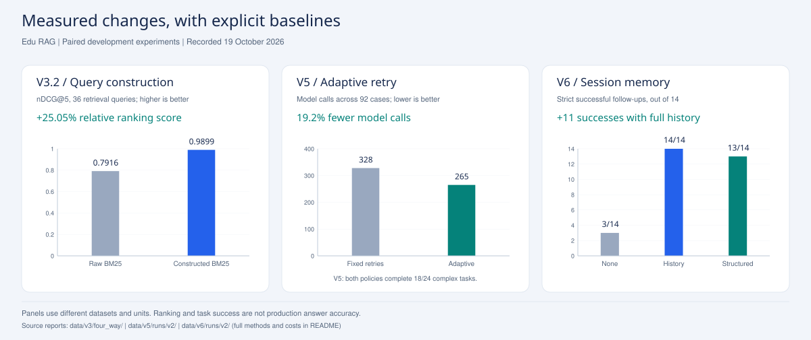
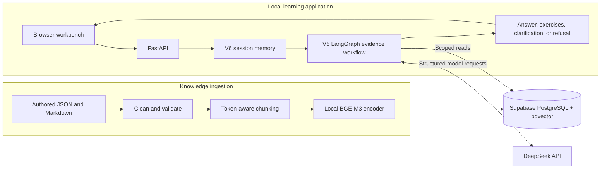
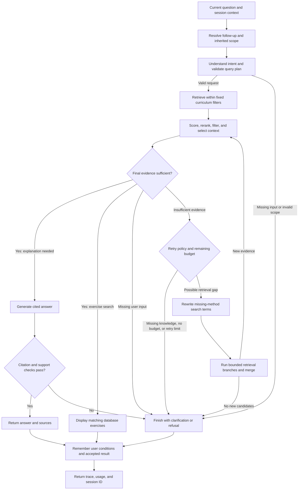
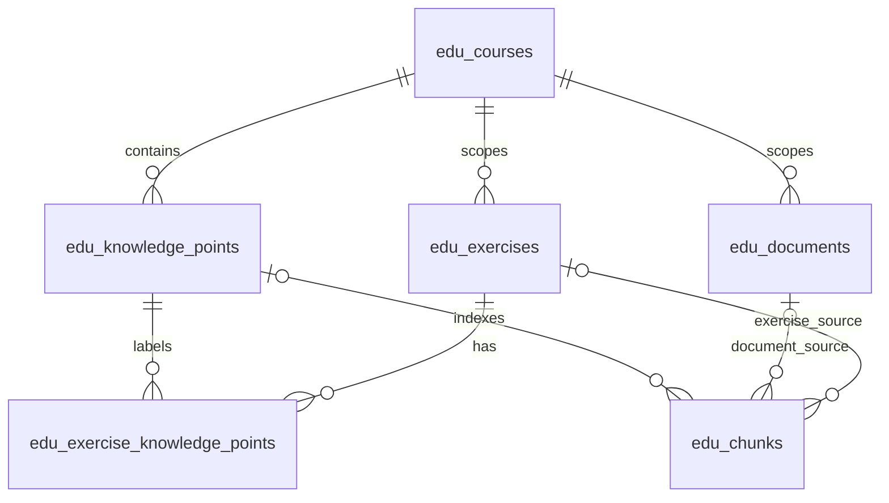

# Edu RAG

**An educational RAG application with structured queries, curriculum-aware retrieval, evidence checks, bounded retries, and conversational memory.**

Edu RAG turns a small, inspectable mathematics knowledge base into a local learning workbench. Students can explore concepts, request exercises, solve a problem, or summarize the material available for a course. A FastAPI backend combines local BGE-M3 embeddings, BM25, reciprocal rank fusion (RRF), and DeepSeek. LangGraph controls when to retrieve, retry, answer, ask for clarification, or decline an unsupported request.

**Current version: 0.6.0 / V6.** The application and evaluated curriculum are primarily Chinese; this README provides an English explanation. The corpus, prompts, code snapshots, responses, citations, and evaluation records are available for inspection.

[Quick start](#quick-start) · [Architecture](#architecture) · [Measured improvements](#measured-improvements) · [Repository structure](#repository-structure) · [Evaluation and reproducibility](#evaluation-and-reproducibility) · [Previous Chinese README](README.zh-CN.md)

## Results at a glance

| Change | Before → after | Measured effect | Experiment |
| --- | --- | --- | --- |
| Add structured query construction, intent routing, and metadata filters to BM25 | nDCG@5: **0.7916 → 0.9899** | **+25.05% relative** ranking score; Recall@5 **+6.06 percentage points** | V3.2, 36 retrieval queries |
| Add score filtering and reranking before independent evidence gating | Positive tasks completed: **29/32 → 32/32** | **+9.38 percentage points** completion; filtering accounts for the main completion gain | V4.1, fixed first-round candidates |
| Replace fixed single-branch retries with evidence-gap-driven branches and early stopping | Model calls: **328 → 265**; tokens: **428,776 → 392,867** | **19.2% fewer calls**, **8.4% fewer tokens**, with the same **18/24** complex tasks completed | V5, 92 cases per policy |
| Add full session history to the same V5 workflow | Successful answerable follow-ups: **3/14 → 14/14** | **11 additional follow-ups**, **+78.57 percentage points**; whole-conversation tokens **+11.5%** | V6, 14 dialogues / 36 turns per mode |



These are separate, paired **development experiments**, each with its own question set and denominator. They measure ranking, completion, cost, and follow-up success respectively. They do not establish production answer accuracy. The [detailed results](#measured-improvements) include the cost trade-offs, cases without improvement, and original records.

## What the application does

The core workflow is:

> Understand the query → enforce curriculum scope → select a retrieval strategy → organize and assess evidence → answer or display exercises.

Four intents keep different tasks from being handled as generic similarity search. The examples below are English translations of the kinds of Chinese requests used by the application.

| Intent | Example | Handling |
| --- | --- | --- |
| `knowledge_qa` | “Why do we regroup when subtracting?” | Find explanatory knowledge cards within the selected curriculum. |
| `knowledge_summary` | “Summarize the available Grade 3 mathematics topics.” | Traverse the available catalog and track topic coverage; support grade, course, chapter, and topic scope. |
| `exercise_search` | “Find five easy rectangle-area calculation exercises.” | Apply question-type, difficulty, topic, and quantity constraints; return actual database exercises. |
| `problem_solving` | “A rectangle is 8 cm long and 3 cm wide. What are its perimeter and area?” | Preserve the complete problem, retrieve methods and examples, then generate and verify a cited explanation. |

Summarizing a particular problem or its solution belongs to `problem_solving`. Course and chapter summaries use `knowledge_summary`. The code supports chapter hierarchies, but the current demo corpus has flat knowledge points and provides no positive real-chapter summary benchmark.

The workbench also exposes knowledge-card text, exercise answers and explanations, retrieval candidates, selected evidence, workflow decisions, retry paths, and usage. Only the latest result is shown in the current UI; a scrolling chat transcript has not been implemented.

## Architecture

### Data and request paths



The browser talks to the local backend. PostgreSQL stores readable knowledge text, exercise records, metadata, and vectors. DeepSeek handles query understanding, evidence scoring and assessment, rewriting, answer generation, and verification. BGE-M3 runs locally for indexing and semantic retrieval.

### LangGraph control flow

V6 wraps the V5 evidence graph in an outer `answer → remember` graph with `InMemorySaver`. Follow-up resolution runs inside the same per-request model budget as retrieval and generation.



LangGraph supplies state, nodes, conditional edges, loops, and checkpoints. The application implements the educational rules, SQL filters, evidence tests, retry policy, and budgets. Retrieval branches execute sequentially inside a node; they are bounded subqueries, rather than separate autonomous agents.

### Structured queries and curriculum scope

A request is converted into a Pydantic-validated plan with an allowlisted intent and filters. For example, “Find five easy Grade 3 rectangle-area calculation exercises” can produce this illustrative plan excerpt:

```json
{
  "intent": "exercise_search",
  "search_text": "长方形 面积 计算题",
  "filters": {
    "subject": "math",
    "grade": 3,
    "knowledge_point": "长方形面积",
    "question_type": "calculation",
    "difficulty": "easy"
  },
  "limit": 5,
  "needs_clarification": false
}
```

The actual plan additionally records effective scope, resolved topic IDs, semantic and lexical search text, parser origin, and usage. The model produces structured data; the backend converts validated fields into bound parameters for predefined SQL.

- Course, grade, subject, textbook edition, semester, and knowledge-point constraints apply **before ranking and LIMIT**. Constraints combine with AND and are retained during retries.
- Explicit API scope takes precedence over inferred conditions. Contradictory or unavailable scope returns an empty result or a clarification.
- `semester` values are `first`, `second`, and `full_year`, with exact matching. Omitting a filter means all values; `full_year` is a stored course label.
- Difficulty is an internal 1–5 label: `easy` = 1–2, `medium` = 3, `hard` = 4–5. Exact numeric levels are also supported.
- If only two eligible exercises exist, the system reports two and explains the shortage. It does not silently relax difficulty, question type, or curriculum scope.

### Retrieval, context selection, and evidence gating

Three retrieval modes are available: `bm25`, `dense`, and `hybrid`.

1. **BM25** uses local Chinese unigram/bigram tokenization, retaining numbers, decimals, and complete exercise IDs. The corpus is loaded after curriculum filtering; its default 5,000-document bound fails explicitly instead of silently truncating.
2. **Dense retrieval** uses normalized, 1,024-dimensional BGE-M3 vectors and exact cosine similarity in pgvector. Model revision and encoding settings form part of the vector identity, preventing incompatible encodings from being mixed.
3. **Hybrid retrieval** fuses BM25 and dense ranks with RRF: `score(d) = Σ 1 / (k + rank(d))`, using `k = 60` by default. A document contributes only for lists in which it appears.

Exercise retrieval prioritizes database tags. Summaries use a catalog-oriented path to improve coverage. The V3 workbench initially selects BM25 and the free local rules parser; the V4–V6 workflow APIs default to DeepSeek query construction and hybrid retrieval. V5 retry branches explicitly use hybrid retrieval.

Context selection and answerability assessment are separate operations:

- An LLM scores each candidate for direct relevance and must provide a verbatim supporting quote. Invalid quotes reduce the usable score to zero.
- The default workflow orders candidates by score and filters below **0.75**, then applies the context-size budget.
- A separate gate checks the **selected final context**, requiring support for all identified requirements; summaries also require at least **90%** of the relevant catalog coverage.
- Answer generation is followed by citation-ID and support checks. Exercise-search results come directly from stored exercises, without a separate answer-generation call.

The 0.75 relevance threshold is a heuristic inherited from the development workflow. The ablation tested its inclusion, not a threshold sweep or probability calibration.

### Bounded retries and conversational memory

Evidence gaps are classified as missing user input, missing knowledge or provenance, or a possible retrieval gap. Only a retrieval gap should motivate rewritten searches. Rewrites preserve the original problem and constraints, cannot introduce new numeric conditions, and stop when no new evidence is found. Citation identities remain attached to the same source chunks across retries.

| Per-request control | Default | Purpose |
| --- | ---: | --- |
| `max_retries` | 2 | Bound re-retrieval rounds. |
| `max_branches` | 3 | Bound subqueries per retry round; at most 7 searches including the first pass. |
| `max_model_calls` | 10 | Count model requests at the HTTP boundary, including failed calls and parser fallback attempts. |
| `max_total_tokens` | 30,000 | Use conservative admission estimates, then record actual provider usage. |
| `max_elapsed_seconds` | 90 | Check elapsed time between nodes and constrain model-request timeouts. |

The token check uses an estimate rather than an exact tokenizer hard limit. Already-running local embedding and database operations are not forcibly interrupted by the elapsed-time budget. Exhausted budgets return `budget_exceeded` with an explicit stop reason.

V6 offers three memory representations:

| Mode | Context supplied to the workflow | Role |
| --- | --- | --- |
| `none` | No prior turns or inherited scope | Controlled baseline. |
| `history` | User turns and workflow-accepted answers from the session | Best completion in the short-dialogue experiment. |
| `structured` | Latest four deterministic task records and current scope | Default API mode; bounded records, with clarification when older necessary context is missing. |

Memory resolves references such as “What about the area?” into a standalone problem before retrieval. Current user changes override inherited values. Only user-provided conditions and accepted prior results may supply numbers; a numeric check is a limited safeguard and does not prove complete semantic fidelity. Historical answers are not treated as knowledge-base evidence.

Sessions are local to one process: up to **32 sessions**, **12 requests per session**, and **30 minutes idle TTL**. Restarting clears the checkpoints. Memory resolution shares the existing request budget. `structured` is not an LLM-generated narrative summary; durable memory, cross-worker sharing, and long-term user profiles remain future work.

## Measured improvements

All tables below are derived from committed experiment artifacts. Positive completion means a returned `answered` or `exercises_found` status. A negative status flag means an unanswerable case was returned with a completion status. Neither is, by itself, a semantic accuracy or hallucination metric. **pp** means percentage points.

### 1. Query construction: better targeting and ranking

**Controlled setup:** 114 fixed vector chunks; 51 authored development questions consisting of 36 retrieval questions, 6 summaries, and 9 empty-result/clarification cases. The retrieval comparison uses Top-5, 20 candidates per branch, shared query plans, and the same corpus snapshot.

| Configuration | Hit@5 | MRR@5 | nDCG@5 | Recall@5 |
| --- | ---: | ---: | ---: | ---: |
| Raw BM25 | 100.00% | 0.7778 | 0.7916 | 91.04% |
| Raw hybrid | 91.67% | 0.7106 | 0.7272 | 82.70% |
| Query construction + BM25 | 100.00% | **1.0000** | **0.9899** | **97.10%** |
| Query construction + hybrid | 100.00% | **1.0000** | **0.9899** | **97.10%** |

Relative to raw BM25, query construction increases nDCG@5 by **0.1983 / 25.05% relative**, MRR@5 by **0.2222**, and Recall@5 by **6.06 pp**. Per-query nDCG improves on 18 questions and ties on 18. The gain combines intent routing, metadata filtering, query construction, and context organization.

Dense retrieval provides **no additional measured gain after query construction** on these relevance metrics. Estimated median request time rises from 146 ms for raw BM25 to 1,640 ms for constructed BM25, including paid query parsing; constructed hybrid takes about 2,049 ms. These are development function measurements, not production HTTP latency benchmarks.

Under the same ten-source summary budget, topic coverage increases from **85.00% to 88.19%**, while context relevance increases from **63.33% to 100%**. All nine empty-result/clarification cases are correctly handled at the retrieval-plan stage after query construction; raw retrieval returns fragments in all nine. This does not imply that a downstream raw-answer model would necessarily answer them incorrectly.

Evidence: [method and limitations](docs/four-intent-ablation.md) · [full numeric report](data/v3/four_way/report_deepseek.json) · [fixed question set](data/v3/four_way/eval.json).

### 2. Context filtering and independent gating: more completed tasks

**Controlled setup:** 92 cases per strategy, comprising 32 answerable and 60 unanswerable cases. Five strategies share fixed first-round candidates and context budgets; re-retrieval is disabled to isolate context selection.

| Context policy | Positive completion | Negative status flags | Nominal calls | Nominal tokens |
| --- | ---: | ---: | ---: | ---: |
| Retrieval order + gate | 29/32 | 0/60 | 107 | 103,013 |
| Rerank only + gate | 30/32 | 0/60 | 160 | 162,040 |
| Filter only + gate | **32/32** | 0/60 | 142 | 133,954 |
| Rerank + filter + gate | **32/32** | 0/60 | 142 | 133,986 |
| Retrieval order, pre-generation gate disabled | 29/32 | 2/60 | 75 | 67,010 |

Reranking plus filtering completes **three additional tasks / +9.38 pp** relative to retrieval order. Filter-only recovers the same three tasks, so the completion gain is mainly attributable to filtering. The combined policy uses **30.1% more tokens** than the retrieval-order gate baseline.

Reranking alone improves the label-based context nDCG proxy from **0.7428 to 0.8940** on 30 non-summary positives, but yields only one net additional completion. Once scoring is needed for filtering, sorting the existing scores requires no extra model request; this is why the combined policy is retained.

The pre-generation gate reduces negative status flags from **2/60 to 0/60** and prevents unsupported requests from entering answer generation. Semantic review found one flag was a refusal mislabeled as answered, and the other displayed unrelated exercises. The result supports better routing and gating, not a claim that factual hallucinations fell from 3.33% to zero. The **≤5%** target is met under this regression set's status definition, without a production-rate guarantee.

Evidence: [ablation design and reviewed failures](docs/rerank-gate-ablation.md) · [numeric report](data/v4/rerank_ablation/v2/report.json) · [paired analysis](data/v4/rerank_ablation/v2/paired_analysis.json).

### 3. Adaptive branches: modest recovery with lower retry cost

**Controlled setup:** 24 newly authored complex positives, 8 simple controls, and 60 reused negatives; 92 cases per policy and 276 saved outputs. Policies share initial plans, first retrieval results, scoring, gating, generation, verification, and budgets.

| Metric | Single pass | Fixed single-branch retries | Adaptive branches |
| --- | ---: | ---: | ---: |
| Complex tasks completed | 17/24 | 18/24 | **18/24** |
| Simple tasks completed | 8/8 | 8/8 | 8/8 |
| All positives completed | 25/32 | 26/32 | 26/32 |
| Negative status flags | 0/60 | 0/60 | 0/60 |
| Nominal model calls | 224 | 328 | **265** |
| Nominal tokens | 356,720 | 428,776 | **392,867** |
| Cases stopped by budget | 0 | 8 | **1** |

Compared with single pass, adaptive retrieval recovers **one complex task / +4.17 pp**, using **18.3% more calls** and **10.1% more tokens**. Compared with fixed retries, it preserves completion while saving **63 calls / 19.2%** and **35,909 tokens / 8.4%**. Early stopping on negative cases accounts for a substantial share of the overall saving.

One inspectable recovery is `complex-17`: “With 96 yuan, buy books at 8 yuan each, then distribute them equally across three shelves.” The first context misses the required division method. Adaptive retrieval adds a relevant card and produces **12 books, 4 per shelf**, after one retry and seven calls; fixed retry takes two retries and ten calls.

Completion and correctness remain separate. A review of completed outputs identified an ambiguous ending in `complex-07`, confusing remaining inventory with the remainder after packing. The ambiguity is retained in the record; the net paired recovery remains one task after conservatively excluding that unclear core result.

Calls and tokens in this table are **nominal independent-run usage**, including shared parsing for each policy. Exact-request caches reduce actual repeated experimental calls. They are not invoice totals.

Evidence: [workflow and experiment](docs/V5.md) · [numeric report](data/v5/runs/v2/report.json) · [paired paths and costs](data/v5/runs/v2/analysis.json) · [answer audit](data/v5/runs/v2/answer_audit.json).

### 4. Memory: recovering context-dependent follow-ups

**Controlled setup:** 14 original dialogues, 36 turns per mode, and 108 outputs. Each mode has 14 answerable follow-ups, 3 unanswerable follow-ups, and 19 setup turns. The underlying V5 algorithm, corpus, thresholds, and budgets are unchanged.

| Metric | No memory | Full history | Latest 4 structured records |
| --- | ---: | ---: | ---: |
| Answerable follow-ups completed | 3/14 | **14/14** | 13/14 |
| Strict follow-up success | 3/14 | **14/14** | 13/14 |
| All 36 turns: tokens | 152,731 | 170,275 | 164,081 |
| All-turn token change vs. no memory | — | **+11.5%** | **+7.4%** |
| All 17 follow-ups: calls | 29 | 80 | 74 |
| All 17 follow-ups: tokens | 52,563 | 74,158 | 67,964 |
| Negative status flags | 0/3 | 0/3 | 0/3 |
| Mean follow-up memory context, characters | 0 | 408.6 | 498.0 |

Full history adds **11 successful follow-ups / +78.57 pp**. Structured memory adds **10 / +71.43 pp**. Strict success combines status, listed condition and scope checks, and a perfect Ragas answer-match score; exercise requests instead use actual tags and quantity checks. It remains a development proxy rather than independently annotated mathematical accuracy.

The structured window forgets the original problem in the dedicated long-history case and correctly asks the user to restate it. Its lower token total partly reflects that missing answer. Its field overhead also makes context longer in these short dialogues. Therefore, **equal-quality context-compression savings have not been demonstrated**. Full history is the best-performing choice for this tested short-session scenario; the API default remains `structured`.

All three modes send identical first-turn provider requests. Every turn stays within ten model calls. The three negative follow-ups are too few to validate a real-world ≤5% error target.

Evidence: [memory design and session limits](docs/V6-memory.md) · [results](data/v6/runs/v2/report.md) · [analysis](data/v6/runs/v2/analysis.json) · [database fingerprint audit](data/v6/runs/v2/database_audit.json).

### 5. Ragas: answer quality and evidence diagnostics

Ragas **0.4.3**, with a DeepSeek judge, evaluates the saved V5 outputs without regenerating answers or accessing the database. Standard metrics apply only to completed positive cases; abstentions are reported separately. Values below are **0–1 scores**.

| Metric | Single pass, n=25 | Fixed retries, n=26 | Adaptive, n=26 |
| --- | ---: | ---: | ---: |
| Faithfulness | 0.5459 | 0.5249 | 0.5249 |
| Factual correctness, F1 | 0.8872 | 0.8838 | 0.8838 |
| Context precision | 0.9767 | **0.9776** | **0.9776** |
| Context recall | 0.7533 | **0.7628** | **0.7628** |
| Answer accuracy / reference-match score | 0.9700 | **0.9712** | **0.9712** |
| All-positive utility, n=32 | 0.7578 | **0.7891** | **0.7891** |

All-positive utility is a project-defined metric: the sum of answer-match scores divided by all 32 positive cases, with unanswered cases assigned zero. Its increase is **+3.13 pp**, driven by one additional answer. On the 25 commonly answered questions, the three policies have identical metric means.

The high **0.9712 reference-match score is not 97.12% mathematical accuracy**. Standard Faithfulness checks retrieved text without adding the user's numerical premises, which can penalize correct arithmetic derived from a general method card. Conversely, reference matching can miss ambiguous wording such as `complex-07`. Both findings are preserved. The generator and judge use the same model family, and independent human review remains necessary.

Evidence: [metric definitions and installation](docs/ragas-evaluation.md) · [full report](data/evaluation/ragas/runs/v1/report.md) · [per-item scores](data/evaluation/ragas/runs/v1/scores.jsonl).

## Knowledge base and data model

The imported demo inventory contains **3 courses, 31 knowledge points, 32 documents, 81 exercises, and 114 chunks with real embeddings**. These counts describe the recorded demo database; a fresh clone needs the initialization and import steps below.

| Curriculum slice | Knowledge points | Exercises | Embedded chunks |
| --- | ---: | ---: | ---: |
| Grade 3, full-year demo | 16 | 51 | 69 |
| Grade 1, first semester | 8 | 16 | 24 |
| Grade 1, second semester | 7 | 14 | 21 |
| **Total** | **31** | **81** | **114** |

The content is authored demonstration material, not a complete textbook. Grade 1 topics reference a supplied public topic list; explanations and exercises were rewritten rather than copying the page or its images. The 81 exercises currently include **64 at difficulty 1 and 17 at difficulty 2**, with 55 calculation, 4 fill-in-the-blank, and 22 short-answer questions. Medium/hard and multiple-choice positive retrieval results cannot be evaluated with this corpus.

Sources: [Grade 3 knowledge cards](data/v1/math_g3.md) · [Grade 1 first semester](data/g1/math_first.md) · [Grade 1 second semester](data/g1/math_second.md) · [import provenance and counts](docs/G1-import.md).



Each chunk comes from exactly one document or one exercise. Composite foreign keys enforce course consistency. Exercise chunks encode the question stem; the corresponding stored answer and explanation are joined when needed. `edu_schema_migrations` tracks applied migrations. Exact vector search is used at this scale; an approximate HNSW index has not been introduced.

Data preparation normalizes Unicode and whitespace while preserving mathematical symbols, removes explicitly declared boilerplate and adjacent duplicate prose, and splits on headings, paragraphs, and logical pages. The default chunk budget is **448 BGE tokens**, with at most **48 tokens** of eligible paragraph overlap. Formulas, tables, code, and example blocks remain intact; oversized blocks and exercise stems fail explicitly instead of being silently truncated. Chunk provenance includes hashes, processing versions, headings, page positions, and token counts. See [V2 preprocessing and scope](docs/V2.md) and the [database design](docs/database.md).

## Technology stack

| Layer | Implementation |
| --- | --- |
| Backend | Python 3.11 verified baseline; FastAPI, Uvicorn, Pydantic |
| Workflow and memory | LangGraph 1.2.16; conditional state graphs; process-local `InMemorySaver` |
| Database | Supabase PostgreSQL, pgvector, SQLAlchemy, psycopg |
| Embeddings | `BAAI/bge-m3`, FlagEmbedding; 1,024 dimensions; verified CPU/FP32 configuration |
| Retrieval | Chinese BM25, exact dense cosine search, RRF, metadata and catalog paths |
| LLM | DeepSeek HTTP API; recorded experiments use `deepseek-flash` |
| Evaluation | pytest; controlled ablations; Ragas 0.4.3 in an isolated environment |
| Frontend | A static HTML/CSS/JavaScript workbench served by FastAPI |

The pinned Windows/Python environment is recorded in [requirements-v4-lock.txt](requirements-v4-lock.txt), which includes the earlier application and model locks. Despite its historical filename, it remains the application lock for V5 and V6. No local Docker service or frontend build step is required.

## Quick start

Run these commands from the repository root, the directory containing `pyproject.toml`. They are written for PowerShell; adjust paths to your own Conda installation. Existing installations can keep their configured environment and database.

### 1. Create the Python environment

```powershell
git clone https://github.com/yingqilin-32/Edu_RAG.git
Set-Location Edu_RAG
conda env create -f environment.yml
conda activate edu-rag
python -m pip install -r requirements-v4-lock.txt
python -m pip install --no-deps --no-build-isolation -e .
```

If activation is blocked by PowerShell policy, use the environment's Python executable directly. The call operator `&` is required when executing a path stored in a variable:

```powershell
$ragPython = 'D:\Anaconda\envs\edu-rag\python.exe'
& $ragPython --version
# Example: & $ragPython -m pip install -r requirements-v4-lock.txt
```

### 2. Configure the database and DeepSeek

Create a dedicated Supabase project, copy `.env.example` to `.env`, and fill the database settings from **Connect → Session pooler**. This persistent local backend uses a PostgreSQL connection; it does not need a browser Supabase API key. Copy the actual host, port, and username from the dashboard. See the [official connection guide](https://supabase.com/docs/guides/database/connecting-to-postgres).

```powershell
Copy-Item .env.example .env
notepad .env
```

| Setting | Purpose |
| --- | --- |
| `DB_HOST`, `DB_PORT`, `DB_NAME`, `DB_USER`, `DB_PASSWORD` | PostgreSQL connection parameters from your project. |
| `DB_SSLMODE=require` | Require encrypted database transport. |
| `EMBEDDING_MODEL=BAAI/bge-m3` | Shared indexing and query encoder. |
| `EMBEDDING_DEVICE=cpu`, `EMBEDDING_MAX_LENGTH=512` | Verified encoding settings. |
| `DEEPSEEK_API_KEY` | Needed for DeepSeek parsing, scoring, gating, generation, verification, and judge calls. |
| `DEEPSEEK_BASE_URL`, `DEEPSEEK_MODEL`, `DEEPSEEK_TIMEOUT` | Configurable provider endpoint, model, and timeout; recorded defaults are in `.env.example`. |
| `BM25_MAX_DOCUMENTS=5000` | Maximum scoped corpus loaded for local BM25. |

Keep credentials in `.env`, which is Git-ignored. Database passwords are read as separate connection fields, so do not URL-encode them. Restart the backend after changing configuration. Browsing imported knowledge and V3 BM25 search with `query_mode: "rules"` do not call the LLM; V4–V6 evidence workflows normally do.

### 3. Download the encoder and initialize the corpus

Installing FlagEmbedding installs the library; download the model weights separately. The application loads the local Hugging Face cache and does not silently fetch missing weights during a request.

```powershell
python -c "from huggingface_hub import snapshot_download; snapshot_download(repo_id='BAAI/bge-m3')"
python -m edu_rag.db migrate
python -m edu_rag.db seed
python -m edu_rag.ingest demo
python scripts/import_g1.py
python -m edu_rag.db check
```

`migrate` applies missing schema versions; `seed` creates the V0 baseline; the two imports extend it to the recorded demo inventory. Repeating unchanged imports preserves existing vectors and stable records. A model revision or encoding-setting change requires re-embedding with the same configuration used for queries. Existing databases should use `migrate`; the historical `supabase/bootstrap_v0.sql` is an alternative initial bootstrap, not an upgrade script to rerun.

### 4. Start the workbench

```powershell
python -m uvicorn edu_rag.main:app --host 127.0.0.1 --port 8000
```

Open the [learning workbench](http://127.0.0.1:8000/) or [interactive API documentation](http://127.0.0.1:8000/docs). `/health` checks the application; `/health/db` checks the database connection and schema.

For a memory demonstration, select V6 and full-history mode. Ask “长方形长8厘米、宽3厘米，周长是多少？” (rectangle perimeter), then “那面积呢？” (what about its area?), and then “把长改成10厘米，宽不变，面积是多少？” (change the length to 10 cm, keeping the width). The workbench displays the resolved question, selected sources, and workflow usage.

## API examples

| Endpoint | Purpose |
| --- | --- |
| `GET /api/v3/courses` | Browse available courses and counts under optional scope filters. |
| `GET /api/v3/knowledge-points` | List knowledge points in the selected curriculum. |
| `GET /api/v3/knowledge-points/{id}` | Read the card, exercises, answers, and explanations. |
| `POST /api/v3/plan` | Inspect a structured query plan. |
| `POST /api/v3/search` | Inspect BM25, dense, or hybrid retrieval with optional query construction. |
| `POST /api/v5/ask`, `POST /api/v5/search` | Use the adaptive evidence workflow with or without answer generation. |
| `POST /api/v6/ask`, `POST /api/v6/search` | Use the same workflow with session memory. |
| `DELETE /api/v6/sessions/{session_id}` | Delete a session and its checkpoints. |

V1–V4 routes remain available for compatibility. The complete schema is exposed in `/docs`.

The following is a V6 request body; its Chinese question asks for a rectangle's perimeter:

```json
{
  "question": "长方形长8厘米、宽3厘米，周长是多少？",
  "grade": 3,
  "subject": "math",
  "memory_mode": "history",
  "query_mode": "deepseek",
  "retrieval_mode": "hybrid",
  "top_k": 5,
  "max_retries": 2,
  "max_branches": 3,
  "max_model_calls": 10,
  "max_total_tokens": 30000,
  "max_elapsed_seconds": 90
}
```

Send it to `POST /api/v6/ask` without a `session_id` to create a session. For a follow-up such as “那面积呢？”, send the returned `memory.session_id` and the same `memory_mode`. Scope and budget fields can be supplied again as needed. The API accepts the session ID rather than arbitrary client-supplied history.

Responses include the original and resolved questions, query plan, selected sources, citation references, status, workflow trace, retry/branch history, model usage, budget information, and memory metadata. Search-only requests read session context without committing a new conversational turn; they can still perform model-based evidence checks.

## Import your own material

Use authorized UTF-8 JSON content with Markdown bodies, explicit curriculum metadata, source and permission information, knowledge points, and optional exercises. [The cleaning example](data/v2/cleaning_example.json) is a starting format.

```powershell
# Preview cleaning and chunking without writing to the database.
python -m edu_rag.ingest preview --file data/v2/cleaning_example.json --chunk-tokens 120 --overlap-tokens 24

# Import an authorized dataset and generate its vectors.
python -m edu_rag.ingest import --file data/my_book.json

# Rebuild missing vectors or vectors for a changed encoder configuration.
python -m edu_rag.ingest embed
```

Use `--no-embed` to import text without vector generation. The importer rejects conflicting metadata for an existing course and invalidates affected vectors when text changes. PDF extraction, OCR, image understanding, and automatic textbook acquisition are not implemented. Detailed format and processing rules are in [V2](docs/V2.md).

## Evaluation and reproducibility

### Application checks

The V6 code baseline passed **184 automated tests** and **8 real HTTP integration checks**. Tests cover structured plans, scope isolation, retrieval, evidence gates, retry and call bounds, missing context, session expiry, and memory modes. These checks complement the experimental reports; they are not an independent answer-quality benchmark.

```powershell
python -m pytest -q -p no:cacheprovider

# With the local backend running; performs real model requests.
python scripts/verify_memory_live.py
```

Read the saved [V6 HTTP checks](data/v6/runs/v2/live_integration.json) and [database audit](data/v6/runs/v2/database_audit.json). Database-contract SQL in `tests/database_contract.sql` is intended for a disposable test database, not normal ingestion.

### Read saved results or repeat an experiment

| Question | Experiment entry point | Saved evidence |
| --- | --- | --- |
| Does structured query construction improve retrieval? | `scripts/evaluate_four_way.py` | `data/v3/four_way/` |
| What do reranking, filtering, and gating each add? | `scripts/evaluate_rerank_gate.py` | `data/v4/rerank_ablation/v2/` |
| Do bounded adaptive retries justify their cost? | `scripts/evaluate_v5.py` | `data/v5/runs/v2/` |
| What does Ragas reveal about saved answers? | `scripts/evaluate_ragas.py` | `data/evaluation/ragas/runs/v1/` |
| Does memory improve follow-up handling? | `scripts/evaluate_memory.py` | `data/v6/runs/v2/` |

The Ragas judge requires a **separate Python 3.11 environment** because its locked LangChain 0.3 dependencies conflict with the application's LangChain 1.x stack. Do not install the evaluation lock into the backend environment.

```powershell
python -m venv .runtime/ragas-eval
$evalPython = '.\.runtime\ragas-eval\Scripts\python.exe'
& $evalPython -m pip install -r requirements-eval-lock.txt
& $evalPython -m pip check

# Export the saved V5 answers; no database access or model generation.
python scripts/evaluate_ragas.py
# Judge saved answers; uncached requests use the configured DeepSeek API.
& $evalPython scripts/evaluate_ragas.py --run

# Memory experiment and its answer evaluation.
python scripts/evaluate_memory.py
& $evalPython scripts/evaluate_memory_answers.py
python scripts/report_memory.py
```

Read existing reports without running these commands if you only need the recorded results. Live evaluations may incur API calls; exact-request caches reuse saved responses. Fingerprint guards prevent silently mixing changed inputs, code, or model settings with old experiments. Follow the per-experiment instructions to preserve previous runs and choose a new output version when supported.

Records include fixed questions, reference answers kept outside the application input, corpus fingerprints, code/prompt signatures, source IDs, raw provider responses, usage, failed attempts, and paired analyses. Caches contain request bodies and outputs, without credentials or authentication headers. Supabase retrieval runs use read-only snapshots, with post-run fingerprint checks where recorded.

The highlights figure can be regenerated from the committed JSON reports with `python scripts/render_readme_figures.py` in a documentation environment with `reportlab` installed. Plotting is optional and adds no application runtime dependency.

## Repository structure

```text
Edu_RAG/                         # Local checkout may be named Edu_RAG_V0
├── README.md                    # English project guide and results
├── README.zh-CN.md               # Previous Chinese setup and version notes
├── pyproject.toml               # Package metadata; current version 0.6.0
├── environment.yml              # Conda / Python 3.11 environment
├── .env.example                 # Credential-free configuration template
├── requirements-v4-lock.txt     # Current application environment, V4–V6
├── requirements-eval-lock.txt   # Isolated Ragas environment
├── src/edu_rag/
│   ├── main.py                  # FastAPI routes and workbench entry point
│   ├── config.py, db.py         # Settings, connections, migration and checks
│   ├── ingest.py                # Validated import and incremental vectorization
│   ├── preprocessing.py         # Math-preserving cleaning and token-aware chunks
│   ├── embedding.py             # Local BGE-M3 encoder and model identity
│   ├── scope.py                 # Curriculum constraints and SQL parameters
│   ├── query.py                 # Four-intent structured query construction
│   ├── retrieval.py             # BM25, RRF, and candidate ranking
│   ├── rag.py                   # Scoped retrieval and context organization
│   ├── knowledge.py             # Catalog, cards, and stored exercises
│   ├── workflow.py              # Common evidence state, generation, verification
│   ├── gating.py, deployment.py # Context selection and independent evidence gate
│   ├── adaptive.py              # V5 gap-based branches, rewriting, and early stops
│   ├── budget.py                # HTTP-boundary call and token accounting
│   ├── conversation.py          # V6 session graph and follow-up resolution
│   ├── assessment.py            # Evaluation adapters and audit helpers
│   ├── llm.py                   # DeepSeek requests and usage handling
│   └── static/index.html        # Learning workbench
├── supabase/
│   ├── migrations/              # Versioned PostgreSQL / pgvector schema
│   ├── seed.sql                 # Minimal original seed data
│   └── bootstrap_v0.sql         # Alternative initial schema + seed bootstrap
├── data/
│   ├── v1/, v2/, g1/            # Authored corpus, preprocessing examples, imports
│   ├── v3/four_way/             # Structured-query retrieval ablation
│   ├── v4/rerank_ablation/      # Rerank, filter, and gate comparisons
│   ├── v5/runs/                 # Adaptive-policy responses, costs, and audits
│   ├── v6/runs/                 # Memory ablation and session-level traces
│   └── evaluation/ragas/        # References, judge outputs, and reports
├── scripts/                     # Import, evaluation, reporting, live checks, figures
├── tests/                       # Python tests and a disposable DB contract
└── docs/                        # Detailed version reports and README figure assets
```

## Development milestones

| Stage | Added capability | Main question tested |
| --- | --- | --- |
| V0 | PostgreSQL schema, migrations, seed data, minimal API | Is the data foundation valid? |
| V1 | Original knowledge cards, local embeddings, cited answers | Can the application retrieve actual knowledge and show its sources? |
| V2 | Cleaning, token-aware chunking, curriculum filters | Can ingestion preserve math and keep queries in scope? |
| V3 / V3.2 | BM25 + dense + RRF; four-intent query plans | Does query construction improve targeting and ranking? |
| V4 / V4.1 | LangGraph evidence flow; rerank/filter ablations; independent gate | When should the application answer, clarify, or refuse? |
| V5 | Evidence-gap-driven branches, finite retries, usage budgets | Can difficult requests recover evidence at controlled cost? |
| V6 | Session memory, follow-up resolution, three-mode comparison | Can the application handle context-dependent requests reliably? |

## Current limits and next steps

- **Small authored corpus and development sets.** The demo covers selected Grade 1 and Grade 3 topics. It has no independently annotated held-out user benchmark, medium/hard exercise positives, or real chapter-summary positives.
- **Model-based checks have failure modes.** Generation and judging use the same model family. Reference matching, citation validation, condition keywords, and evidence scores are useful diagnostics, not proofs of correctness.
- **Retrying preserves initial constraints.** An overly narrow initial topic filter can prevent recovery; query rewriting cannot repair absent knowledge or provenance.
- **Memory is a local prototype.** There is no authenticated user ownership, durable checkpoint store, or shared multi-process session state. Random session IDs are local capability identifiers. Keep the default loopback binding for this development application.
- **Budget and speed findings have specific scope.** Call counts are enforced at model HTTP boundaries; tokens use estimated admission. Cache-replayed API-time proxies are not production latency or throughput results.
- **Further evaluation should test generalization.** Priorities are independent human-reviewed questions, realistic textbook coverage, threshold sensitivity, better scope planning, long-history retrieval or summarization, and error propagation across turns.

The database uses RLS-enabled project tables and server-side PostgreSQL credentials; public application authentication and deployment policies remain future work. See the [existing database design](docs/database.md) for the implemented development access model.

## References

The project was developed with reference to [All-in-RAG](https://github.com/yingqilin-32/all-in-rag), [Edu-RAG](https://github.com/easyroc/edu-rag), and the [RAG Web UI tutorial](https://github.com/rag-web-ui/rag-web-ui/blob/main/docs/tutorial/README.md). Its application scaffold and demonstration knowledge content were authored for this project.

Implementation references: [LangGraph graph API](https://docs.langchain.com/oss/python/langgraph/graph-api) · [LangGraph memory](https://docs.langchain.com/oss/python/langgraph/add-memory) · [Supabase PostgreSQL connections](https://supabase.com/docs/guides/database/connecting-to-postgres) · [pgvector on Supabase](https://supabase.com/docs/guides/database/extensions/pgvector). Exact implemented behavior and evaluated dependency versions are recorded in this repository.
