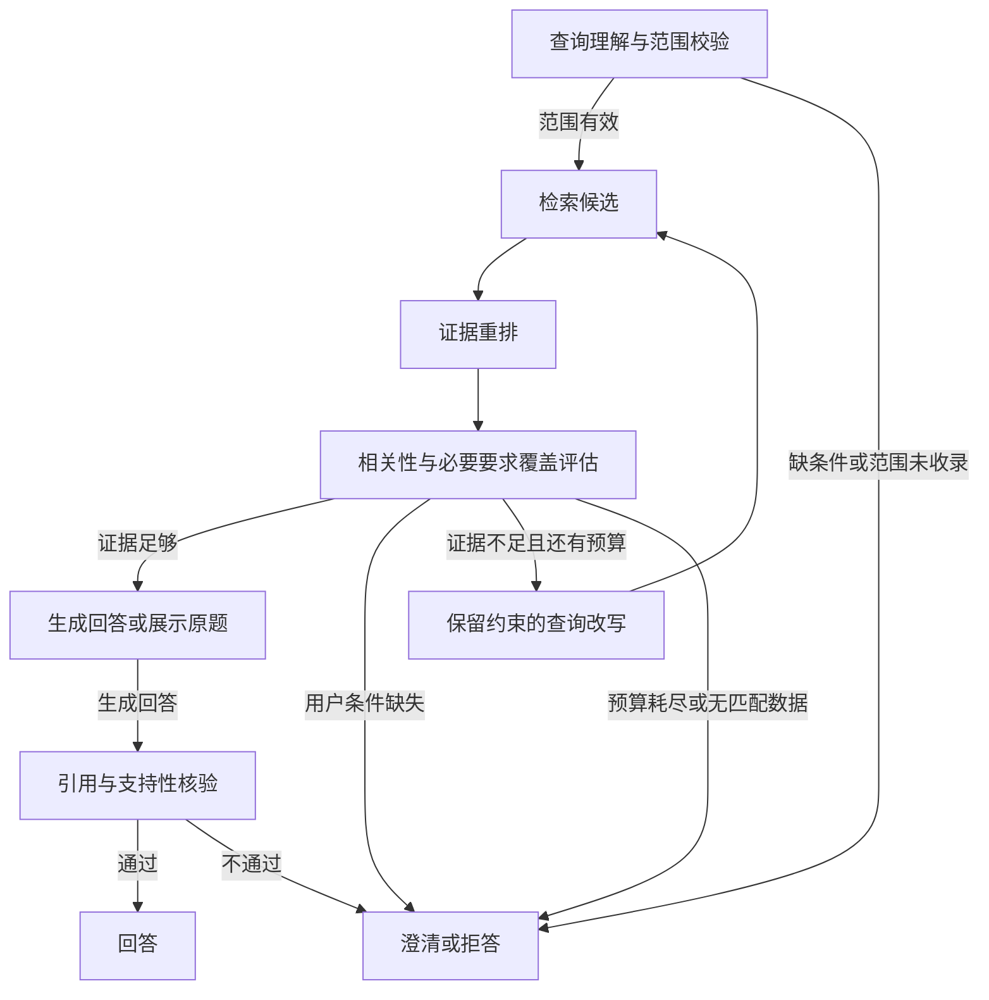

# V4：LangGraph 证据工作流

代码版本0.4.0，目标：不可回答问题的错误作答率≤5%。这是一项需要通过实际样本验收的目标，不是由分数阈值自动保证的概率。

## 实现

使用固定版本LangGraph 1.2.16的StateGraph、条件边和有界循环，沿用V3的课程过滤、BGE-M3向量、BM25和RRF。实现位于 `src/edu_rag/workflow.py`，V1—V3 API保持可用。



- 查询理解复用V3四类意图；显式范围及主题、题号、题型、难度保持约束。
- 检索最多取10条排序候选，最终上下文通常最多5条；总结按目录预算选取，默认20条、最多40条。
- 重排使用DeepSeek的列表式相关性评分，要求摘录真实连续原文。无有效原文摘录的片段分数归零。这是LLM重排，未声称使用另一个BGE Cross-Encoder模型。
- 证据评估检查原始问题的每个必要子要求，要求支持引用确实进入最终上下文。候选池被裁剪时，不能直接沿用整个候选池的覆盖判断；必要时单独复核最终上下文。
- 相关性启发阈值0.75，必要要求覆盖必须100%，总结另要求覆盖至少90%的已收录目录。它们不是校准后的正确概率。只总结已收录资料，不能声称完整教材覆盖。
- 用户缺少尺寸、图片或题干时澄清；未收录范围、无匹配标签或重检后仍不足时拒答。
- 改写只补充检索表达，保留原始问题、数值和筛选约束；不根据检索结果修改题目条件。重检走混合检索，最多2次，即最多3轮检索。无新增表达或改写事实保护失败时提前停止。
- 生成后，先检查引用编号，再由DeepSeek核验草稿结论是否有对应依据。未通过的草稿不展示，返回固定拒答文案。
- 查找练习题直接展示数据库原题与折叠答案，不调用回答生成节点。
- 模型或结构校验失败时安全停止，并记录工作流错误；验收不把服务错误当作健康拒答来宣称完整达标。
- 查询解析的非致命失败可以回退规则解析，单独记录为fallback；证据评估和答案核验仍必须正常完成。可选clarification省略或为null时按空串处理，不因此丢弃有效证据；空requirements的覆盖率始终为0。

完整流程最多11次模型调用：1次解析、最多3轮重排及最终上下文复核、2次改写、1次生成、1次答案核验。许多问题提前停止，实际调用更少。每个节点启动前检查180秒软预算；不会取消已经发出的单次模型请求。图递归上限35，防止意外无限循环。

## 使用

```powershell
$ragPython = 'D:\Anaconda\envs\edu-rag\python.exe'
& $ragPython -m pip install -r requirements-v4-lock.txt
& $ragPython -m pip install --no-deps --no-build-isolation -e .
& $ragPython -m uvicorn edu_rag.main:app --host 127.0.0.1 --port 8000
```

没有新增数据库迁移，也无需重新生成已有向量。配置沿用本机 `.env` 的数据库连接、BGE-M3及DeepSeek密钥。

工作台选择“V4 · 证据评估与有限重检”，可以设重检0—2次。V4的“仅检索”同样包含付费证据评估；“本地解析”仅表示解析阶段免费，后续评估仍使用API。

```json
POST /api/v4/ask
{
  "question": "长方形长9厘米、宽4厘米，周长和面积分别是多少？",
  "grade": 3,
  "retrieval_mode": "hybrid",
  "query_mode": "deepseek",
  "max_retries": 2,
  "top_k": 5
}
```

`/api/v4/search`执行相同证据流程但不生成讲解。V4不接受关闭查询理解，也不接受超过2次重检。响应状态包括 `answered`、`exercises_found`、`evidence_ready`、`needs_clarification`、`refused`。

## 追踪

响应的 `workflow` 字段包含：

- 唯一trace_id、工作流版本、决策和原因、各节点路径与耗时。
- retry_count及retrieval_count，每轮实际检索文本、不可变范围、候选排名、证据分数与覆盖缺口。
- 调用阶段、模型用量、服务错误和答案核验结果。
- 最终引用的片段ID、来源URI、页码、课程、知识点和题目ID。

相同记录追加写入本地 `.runtime/v4/traces.jsonl`，该目录已被Git忽略。逐题验收报告另外保存在 `data/v4/runs/`，保留原始输出和失败记录。数据库访问维持只读，没有上传运行日志到外部追踪平台。

## 验收口径

固定验收集 `data/v4/eval.json` 包含60道不可回答题（范围未收录、缺用户输入、未知知识、出处信息、部分要求缺证据、对抗请求各10道），另有20道可回答问题。

错误作答率 = 不可回答问题中输出实质回答或展示题目的数量 / 全部不可回答问题数。固定拒答和澄清不计作答；服务异常另外统计。可回答题作答率另设80%的可用性下限，防止靠全部拒答满足目标。该可用性指标不是答案正确率。

验收前核对题库标签、记录问题集/代码/提示词/模型配置/语料指纹。标签和标准理由不会传给工作流。保留开发样例与验收集的区分；修复后若使用相同验收题重测，须注明它已成为回归集，不再视为未见问题。

```powershell
& $ragPython -B scripts/evaluate_v4.py --preflight-only
& $ragPython -B scripts/evaluate_v4.py
# 中断后仅在代码、模型、语料与题集指纹完全一致时恢复
& $ragPython -B scripts/evaluate_v4.py --resume
```

报告给出逐类结果、可回答题作答率、重检分布、引用有效性、服务错误、耗时和用量。报告中的单侧95%二项上界是假定独立、代表性抽样时的参考计算；本项目合成问题不具备这些前提，不能据此承诺生产误答率。

首轮 `runs/v1/report.json` 完整保留：不可回答题0/60错误作答，原始正例12/20作答；有5个服务/解析异常记录，因此未整体通过验收。人工核对原文发现3个正例标签超出资料实际能力（单位方格推导、钟面小格、正方形周长题），另1题需明确包含逆向面积计算。修订理由与原题保存在 `data/v4/label_audit.json`，修订后的 `eval_corrected.json` 明确标为回归集。没有修改知识库来配合标签。

第二轮使用修复后的 `evidence-graph-v2`，修复可选字段缺失、查题动词、用户数值被错误要求出现在资料中，以及改写重复原数值被误拦的问题；同时保留原阈值及全部60道负例。命令为：

```powershell
& $ragPython -B scripts/evaluate_v4.py --run-id v2 --suite eval_corrected.json
```

第二轮是公开失败后修复的回归验收，不能称作全新未见测试，也不能与首轮正例直接计算准确率提升。

## 第二轮实际结果（2026-10-18）

完整报告：[runs/v2/report.json](../data/v4/runs/v2/report.json)，每题原始响应及检索路径同时保存在results.jsonl。该轮保存了执行代码快照，代码和题集指纹在运行期间未变。

| 指标 | 结果 |
| --- | ---: |
| 不可回答题错误作答率 | 0/60 = 0%，满足样本内≤5%目标 |
| 负例处理 | 34拒答、26澄清 |
| 可回答题作答率 | 18/20 = 90% |
| 知识问答 | 8/8作答 |
| 知识总结 | 2/2作答 |
| 解答用户题目 | 5/6作答 |
| 查找练习题 | 3/4展示原题 |
| 服务异常／规则解析回退 | 0／0 |
| 引用编号及片段对应检查 | 全部已输出引用可追溯至本次选中来源 |
| 额外重检0／1／2次 | 59／3／18个请求 |
| 重检上限检查 | 80/80不超过2次重检、3轮检索 |
| 全项目自动测试 | 129项通过 |

预热CPU后的全部80题中位耗时2503ms；负例1659ms，正例7409ms。总体中位数包含大量提前停止的负例，不能当作生成答案的典型耗时。工作台新进程首次载入BGE时，已观察到查题请求约26.5秒，其中约22.6秒在检索节点。这里没有并发负载测试。

第二轮共251次实际模型调用，378727 tokens。真实语料内容、题型和难度前后指纹均为 `22a72e916102416a0fb9f0f205e6ac2f1c73657adc75f3a788aa2b75c9620a6e`；与V3指纹的字段范围不同，增加了来源URI及页码等内容，不应将不同哈希直接解释为数据被修改。

保留两个未作答正例：

- `pos-13`：下午2时20分开始、40分钟后结束。证据评估通过，但生成后核验拒绝草稿，最终没有向用户提供答案；该例说明模型核验仍会影响可用性，不能把它当作人工判定的正确率。
- `pos-18`：查找2道有余数除法计算题。评估对数量及题目含义判断过严，重检两次后拒答。真实题库标签下仍有候选，属于保留的找题可用性问题。

本轮没有可回答题在重检后恢复作答；多轮重检主要确认资料本身缺失，不能宣称查询改写带来了正例作答收益。开发样例曾出现重检恢复，仍需更多独立样本比较固定一轮与多轮的收益及成本。

工作台页面另行验证了V4混合检索、DeepSeek解析、按难度展示2道原题、结构化计划、节点路径、证据覆盖和来源记录，未并入上述80题指标。

这些问题使用同一小型原创语料，不是独立教材或真实用户流量。现阶段没有真实章节层级、中高难度题或初三知识的正向验证。LLM相关性判断及LLM核验可能出现共同偏差，真实上线仍需人工标注和持续采样。

V3先前的空检索测试没有生成回答，不能当作已测的错误作答率基线。

技术依据：[LangGraph Graph API](https://docs.langchain.com/oss/python/langgraph/graph-api)、[安装说明](https://docs.langchain.com/oss/python/langgraph/install)。
