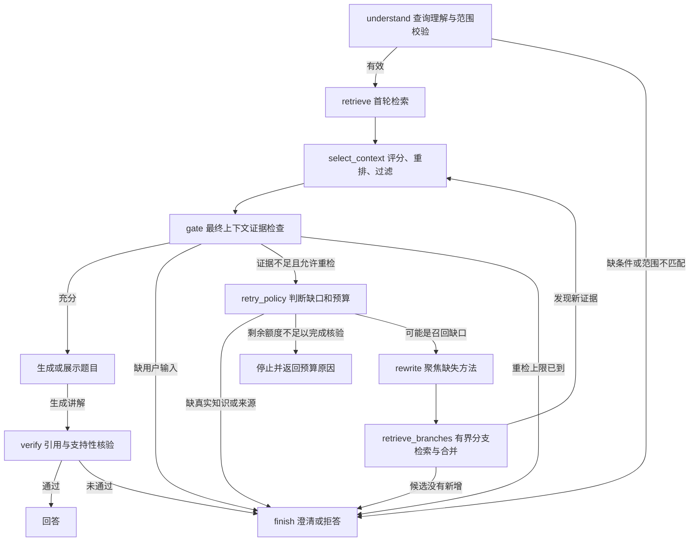

# V5：按证据缺口分支、改写与有限重试

2026-10-19，版本 **0.5.0**。本版完成 LangGraph 流程控制与调用预算，并测量复杂问题收益。结论是：**在这份小型开发集中多恢复了 1 道复杂题；相同完成数下，按需策略比固定重试少用 19.2% 模型调用、8.4% tokens。** 这不是大幅提升或生产准确率保证。

## 实际流程



首轮沿用 V4.1 的 BGE-M3 + BM25 + RRF、模型评分、0.75 过滤和独立证据门控。证据不足后区分用户条件缺失、知识/来源缺失和可能的召回缺口。仅在需要恢复证据时生成 1—3 组方法检索词；保留原题全文作为语义检索输入，关键词检索聚焦缺口。

LangGraph 管理回答、澄清、拒答、预算停止和重检的条件路径。`retrieve_branches` 节点内顺序执行有界的检索子查询，逐分支记录路径；没有宣称使用并行模型 Agent。每个分支都使用原来的课程、年级、教材、学期、题型、难度和知识主题约束。改写不允许加入阿拉伯数字条件。合并时去重、保留先前有用证据并分配各分支候选，候选池最多20条；引用编号绑定片段ID，跨轮不复用为另一个来源。

如果没有新候选，直接停止，避免重复付费评分。缺少真实出处、私人资料等不能靠改写补出的事实时，门控可直接拒答。候选被过滤为空时缺少这次结构化缺口判断，仍可能尝试无效重检，这是保留的成本限制。

## 成本边界

| 参数 | 默认值 | 服务端允许范围 |
| --- | ---: | --- |
| max_retries | 2 | 0—2 |
| max_branches | 3 | 每轮1—3条子查询 |
| max_model_calls | 10 | 1—12 |
| max_total_tokens | 30,000 | 1,000—60,000 |
| max_elapsed_seconds | 90秒 | 5—180秒 |

- 模型调用上限在 HTTP 边界强制执行，包括查询解析、解析回退前已发生的调用、评分、门控、改写、生成、核验及失败请求。没有 SDK 自动重试绕过计数。
- 每次调用设置输出 `max_tokens`。总 tokens 采用保守的 UTF-8 字节预估进行准入，并在响应后按提供商 usage 记账。**这不是精确 tokenizer 给出的总 tokens 硬保证**；缺 usage 时按预估占用预算并标记缺失。
- 准备重试前预留生成与核验所需的2次调用。预算允许的实际重试可能少于 max_retries；例如还剩4次调用，无法同时完成“改写＋评分＋门控＋生成＋核验”，会提前停止。
- 每次模型 HTTP 请求使用剩余时间与配置超时的较小值。已开始的本地 BGE 计算、数据库查询没有强制中断，只在节点之间检查时间，因此不是整个请求的硬实时截止。
- 最多2次重检、每轮最多3个分支，故最多7次实际检索；上限不意味着每个请求都执行满。

预算不足单独返回 `budget_exceeded`，不把它算成服务故障或成功拒答。调用及 token 明细、分支查询、停止原因随 `workflow` 返回，并追加保存到 `.runtime/v5/traces.jsonl`。API 不开放关闭证据门控的选项。

## 三组受控实验

题集共92题：**24道新编复杂正例、8道复用简单正例、60道复用负例**。与 V4.1 的32道正例不是同一题集，不能把本版完成数与旧版32/32直接解释成版本退步。

三组共用相同查询计划、首次候选池、模型、评分/过滤/门控/生成/核验提示词和预算，仅改变后续重试策略：

1. `single_pass`：首轮后结束，不改写。
2. `always_retry`：证据不足时单路重试，不因已知知识缺失或候选重复而提前停止；仍受相同预算约束。
3. `adaptive`：依据缺口选择最多3条分支，已知缺知识或无新增证据时提前停止。

固定重试组使用相同的新节点与聚焦关键词，**不是历史 V4 的逐字节复跑**。同请求体共享原始模型响应缓存，控制相同输入的重复生成波动；不同提示词各只有一次响应。标准答案及正负标签不传给模型。

完整结果：[报告](../data/v5/runs/v2/report.json)、[276条逐题响应](../data/v5/runs/v2/results.jsonl)、[配对分析与路径](../data/v5/runs/v2/analysis.json)、[答案复核](../data/v5/runs/v2/answer_audit.json)。

| 指标 | 单轮 | 固定单路重试 | 按需分支 |
| --- | ---: | ---: | ---: |
| 复杂题完成数 | 17/24（70.83%） | 18/24（75%） | 18/24（75%） |
| 简单题完成数 | 8/8 | 8/8 | 8/8 |
| 全部正例完成数 | 25/32 | 26/32 | 26/32 |
| 负例状态误放行 | 0/60 | 0/60 | 0/60 |
| 92题名义模型调用 | 224 | 328 | 265 |
| 92题名义 tokens | 356,720 | 428,776 | 392,867 |
| 单题观察到的最多调用 | 5 | 10 | 7 |
| 因预算停止的题数 | 0 | 8 | 1 |
| 服务异常 | 0 | 0 | 0 |

按需分支相对单轮多完成 **1/24** 复杂题，即 **4.17个百分点**，没有丢失原来能完成的题；代价为调用增加18.3%、tokens增加10.1%。相对固定重试，在相同完成数下，调用减少 **63/328 = 19.2%**，tokens减少 **35,909/428,776 = 8.4%**。仅看复杂题，调用为104、131、117次；整体节省较大的一部分来自负例早停，不能全部归因于复杂题检索变强。

按需组有21题因没有新增候选提前停止，1题按缺知识直接停止；66题没有执行重检。全部调用、重试、分支及原有范围检查通过。保留门控的三组均为样本内0/60误放行，满足当前回归样本的≤5%目标；这不保证生产误答率。

### 实际恢复的题目

`complex-17`：“96元买每本8元的书，能买几本？平均放到3个架子，每架几本？”

首轮未选入适用的除法知识卡，不能有依据地解答。固定单路策略重检2次，总调用10次；按需策略重检1次，总调用7次。两者均选入新增片段 `3a5d1294-af72-5cd2-94f8-d023d2230af3`，得到 **12本、每架4本**。这次恢复伴随实际新增依据，不只是同一候选重复评分后的波动。

### 完成率与答案质量分开

完成仅指 returned answered / exercises_found，不自动等于答案正确。本助手阅读了26个不同的已完成答案，发现 `complex-07` 虽算出剩余库存495本、可装55包，结尾却写“剩0本书”，混淆库存剩余与装包余数。保守扣除这一条后，复杂题清晰核心结果为 **16/24 → 17/24**；三组共享这条问题，配对增益仍是1题。这是助手复核，非独立人工标注的准确率。

仍有6道复杂题未完成，涉及多方法的既定主题筛选过窄、单位解释证据不足，或预算内未能找到所需乘除法方法。重检保持原约束，不能自动修复初始主题选择。部分已完成答案的相邻引用也不充分，不能声称句句有据。原有负例的部分澄清措辞缺陷亦保留。

### 费用和耗时

按2026-10-19查询到的 [DeepSeek官方Flash定价](https://api-docs.deepseek.com/zh-cn/quick_start/pricing/) 计算，缓存命中/未命中输入及输出的高峰单价分别为每百万tokens 0.04/2/8元，空闲时段为一半。

| 92题名义费用估计 | 空闲时段 | 高峰时段 |
| --- | ---: | ---: |
| 单轮 | ¥0.4215 | ¥0.8430 |
| 固定单路重试 | ¥0.5082 | ¥1.0163 |
| 按需分支 | ¥0.4659 | ¥0.9319 |

这些是按记录usage、缓存计数与当日公开单价估算的**独立运行名义成本，不是本次账单**；共同解析也计入各组名义预算。模型/缓存/时段变化会改变费用。实际实验保存236次不同的提供商响应、261,480 tokens，包含24次新题解析；通过缓存复核时没有新增提供商调用。复用的68题解析不在本次实际扣费里。缺缓存计数的共用解析按全部输入未命中保守估计。

复杂题的可比耗时代理中位数：单轮约5.84秒、固定重试约6.81秒、按需分支约6.33秒。该代理回放相同缓存请求的原始API时长，并加上实际分支检索时长，**排除共用解析及首轮检索，不是HTTP端到端延迟或并发吞吐测试**。真实8项HTTP集成另有完整墙钟耗时记录。

## 代码与接口

- `src/edu_rag/adaptive.py`：LangGraph 条件路径、缺口分类、分支改写、候选合并、无进展早停和引用身份。
- `src/edu_rag/budget.py`：HTTP调用边界的预算计数、输出上限、token准入预估和模型超时。
- `src/edu_rag/workflow.py`：保留V4公共实现，通过 trace_details 钩子加入V5追踪。
- `src/edu_rag/main.py`：新增 `/api/v5/ask`、`/api/v5/search`，V1—V4仍可使用。
- `scripts/evaluate_v5.py`、`scripts/report_v5.py`：固定输入三组实验及离线分析。
- `scripts/verify_v5_live.py`：真实HTTP问答、找题、澄清、拒答和预算停止。

示例：

```json
{
  "question": "三年级数学：96元买每本8元的书，再平均放到3个架子，每架几本？",
  "grade": 3,
  "query_mode": "deepseek",
  "retrieval_mode": "hybrid",
  "max_retries": 2,
  "max_branches": 3,
  "max_model_calls": 10,
  "max_total_tokens": 30000,
  "max_elapsed_seconds": 90
}
```

工作台已增加V5流程和调用预算，可把“最多重检”设为0选择单轮。输出展示调用数、实际返回的tokens、检索分支和停止原因。没有新增必填环境变量、依赖、数据库迁移或向量生成；仍使用原配置和已固定的LangGraph 1.2.16。

## 验证与保留记录

**162项自动测试通过**，包括模型调用硬上限、低token预算、模型截止时间、预算预留、查询解析回退不能绕过计数、重复证据早停、范围及数值保护、引用身份与最大重试次数。前端JavaScript语法检查通过。

**8项真实HTTP集成检查通过**：简单计算、复杂计算、缺宽澄清、未知出处拒答、未收录范围、1次调用上限、1000-token准入预算及仅检索展示题目。[原始集成结果](../data/v5/live_integration.json) 中复杂题实际调用8次完成；1次调用预算只发出1次请求，1000-token预算在发出模型请求前停止。

数据库查询保持只读；实验前后语料指纹均为 `22a72e916102416a0fb9f0f205e6ac2f1c73657adc75f3a788aa2b75c9620a6e`。

首轮成本统计漏掉 `complex-12` 一次解析回退前的调用，生产HTTP计数没有此缺陷。v2补正每组共同的1次调用及2,589 tokens；v1全部结果保留。比较276条结果，状态与答案文本完全一致，复核使用缓存且没有新模型调用。[计数审计](../data/v5/accounting_audit.json) 记录了这一修正。该题的解析回退仍保留，不能宣称所有解析均成功。

```powershell
$ragPython = 'D:\Anaconda\envs\edu-rag\python.exe'
& $ragPython -m pytest -q -p no:cacheprovider
& $ragPython scripts/report_v5.py
# 只读核对当前语料并重建汇总；模型响应均已缓存：
& $ragPython scripts/evaluate_v5.py --summarize-only
# 下列命令会重新调用真实API，需本地8000端口运行V5：
& $ragPython scripts/verify_v5_live.py
```

代码、提示词、题集、原始响应、计划和语料签名均已保存。实验明确属于开发与回归比较，一道题的收益不能视为统计稳定结论。LangGraph提供节点、条件边和循环调度；具体教学方法、缺口判定和预算规则由项目实现。技术依据：[LangGraph Graph API](https://docs.langchain.com/oss/python/langgraph/graph-api)。
