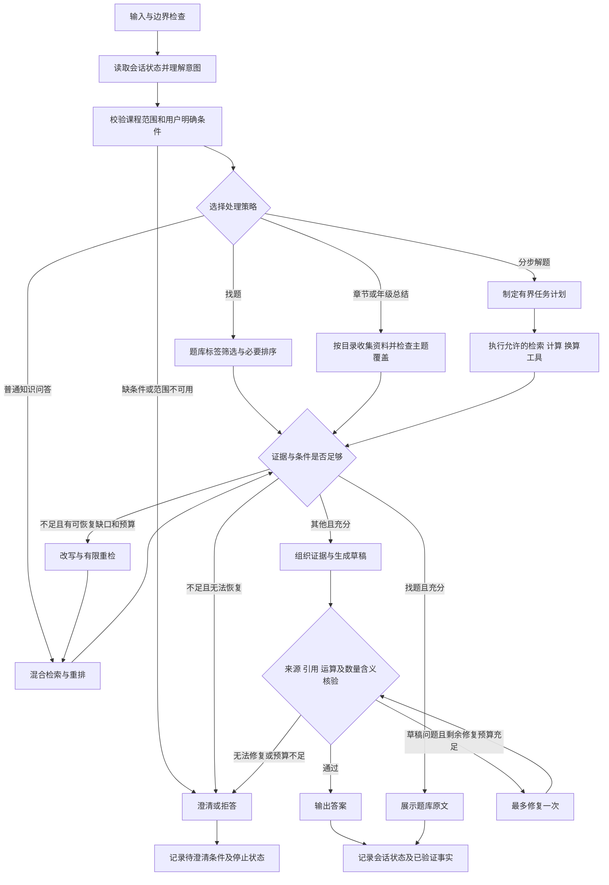

# 借鉴 LangGraph Agent 模板的落地设计

2026-10-19。本文是基于当前 V5 代码的对照与下一阶段设计；表中“建议新增”尚未实现，也未作为当前接口能力发布。

用户提供的模块划分适合本项目。已有意图、检索、门控和有界循环可以继续复用；新增功能应围绕教育问答实际缺口，并分别测量效果与成本。模块是职责划分，不要求每个模块都调用一次大模型。

## 模板与当前代码的对应

| 模块 | 当前实现 | 需要补充的部分 |
| --- | --- | --- |
| Guardrail | `query.py` 合并用户范围、规则抽取与模型解析并检测冲突；`scope.py` 下推课程筛选；`budget.py` 在HTTP边界限制调用与tokens；提示词区分来源文字与系统指令 | 尚无完整独立Guardrail层；需集中表达输入、来源、工具调用和输出边界，并测试注入与跨范围访问。现有范围过滤不等于用户权限认证 |
| Intent | `query.py` 已有知识问答、知识总结、找题、解题四类；含总结层级与题目子任务 | 保留原分类，补充分解所需子任务，避免增加含义重叠的顶层意图 |
| Router | `query.py` 已区分目录总览与筛选检索；`adaptive.py` 根据证据缺口、剩余预算和新候选决定是否改写重检 | 尚无查询开始前的独立复杂度路由；建议增加查题、课程总览、普通问答、分步解题四条策略 |
| Retrieval | `retrieval.py` BM25、Dense及RRF；`gating.py` LLM评分、重排、0.75阈值过滤和独立门控 | 当前Reranker是LLM评分，不是专用cross-encoder。先保留已测基线，单独验证替换的成本收益 |
| Planner / Executor | `adaptive.py` 是预定义流程，含聚焦改写、最多3个检索分支、候选去重与无进展停止 | 尚无通用工具注册表、依赖任务计划、权限执行器、持久化确认或业务幂等机制。可先引入只读检索、算术及单位换算工具 |
| Generate | `rag.py` 根据原题、最终片段及引用生成答案；找题展示题库记录 | 教学讲解与运算结果分开输入，并保留数量、单位和语义标签 |
| Faithfulness | `workflow.py::_verify` 用LLM检查支持性、问题覆盖与引用；失败转为拒答 | 当前没有草稿修复循环，也没有确定性的数学核验；建议增加计算/单位核验，以及预算内最多1次修复 |
| Memory | 图内有请求状态，JSONL保存检索与调用轨迹 | `compile()` 未配置checkpointer，接口没有会话历史输入；没有跨请求对话记忆。日志不能代替Memory |

当前主图在 [adaptive.py](../src/edu_rag/adaptive.py)，V4/V5共用生成后核验在 [workflow.py](../src/edu_rag/workflow.py)，数据与范围规划在 [query.py](../src/edu_rag/query.py)、[rag.py](../src/edu_rag/rag.py)。

## 建议的教育问答工作流

下图中策略分支、工具计划、数学核验、草稿修复及会话存取属于待实现设计，不能据此声称当前代码已经支持。

证据缺口与草稿错误使用不同处理：缺方法才考虑重检；已有充分证据但算错或标签错，进入定向修复。重检、工具规划、修复、摘要均共享请求总预算，不能各自再开启一套重试额度。沿用V5最多2次重检、最多3条分支、默认10次模型调用作为初始对照；是否调整须通过实验。新增修复最多1次，额度不够时可以0次。

## 优先新增的三个能力

### 1. 查询开始前的策略路由

路由应由明确任务需求驱动：

- 题号或严格标签查题优先使用现有确定筛选，需要文字匹配时加入排序。
- 章节或年级总结先取目录和资料，测覆盖率。
- 概念解释复用当前检索与证据门控。
- 多问、单位转换、连续计算或多个方法依赖的问题生成小型任务计划。

可以先用规则和现有结构化解析结果路由，只有无法判断时才增加模型调用。“句子很长”不单独作为复杂题依据。路由结果、理由、计划子任务及预算写入轨迹。

V5仍有部分题因模型推断的知识主题过窄而未完成。例如开始只选“经过时间”，后续固定主题使乘法方法无法召回。新路由/规划应区分：用户明确的课程、年级、教材、学期和主题等约束；系统推断的检索主题集合。前者须保持，后者可在允许课程范围内按子任务修正并留痕；不能通过放宽用户条件提高指标。

### 2. 只读数学工具与分开的核验信号

以 `96元、每本8元、平均放到3个架子` 为例：

1. 保留原题与用户数值来源，检索包含数量关系和平均分的方法。
2. 算术工具计算 `96÷8=12`，记录结果为“购书数量12本”；再计算 `12÷3=4`，记录“每架4本”。
3. 生成讲解时同时使用方法来源、用户条件和工具结果；方法引用仍指向知识卡。
4. 核验最终答案的数值、单位、对象、题目子问和引用。

Calculator只接受限制语法的算术表达式，采用允许的运算与数值类型；不执行模型返回的Python、shell或任意SQL。单位换算只使用明确维护的换算表。输入解析不确定时澄清，不以工具计算结果替用户补条件。

核验信号应分别表示：`method_supported`、`premises_preserved`、`calculation_valid`、`quantity_labels_valid`、`citations_valid`、`addresses_question`。正确运算不证明选对了方法；来源有依据也不证明算式或最终数量含义正确。

已有 [Ragas评估](../data/evaluation/ragas/runs/v1/report.md) 提供两个直接例子：`complex-17` 运算正确但标准Faithfulness为0；`complex-07` 算出了库存495本、55包，末句却把装包余数写成剩余库存，自动答案匹配仍为1.0。应保留原始标准指标，另报告数学及数量含义核验，不把题干或参考答案偷偷加入检索正文来抬分。

### 3. 带预算的草稿修复

当前代码在 `verify → finish` 结束，验证失败会拒答。建议新增 `verify → repair → verify`，最多一次，明确传入失败项及允许使用的证据/计算结果。修复不能改题、捏造来源或静默扩大范围。

例如“库存495本、装55包、装完余0本”应写明不同数量，而不是只改变一个数字。无法验证的修复结果仍停止回答；记录原草稿、失败项、修复次数、最终状态及每次调用成本。

## Memory与工具权限如何按需引入

Memory适用于“再出三道类似的”“把上一题的长度改成10厘米”等追问。首版可保存当前课程/年级/教材、原题、用户明确条件、最近题目ID、待澄清项和已验证结果；较早对话按需摘要。原题数字和筛选条件单独存放，不靠摘要保真。历史答案及摘要不能升级为教材证据；跨请求使用知识卡时，需按当前范围核对来源及版本。

读取和写入记忆分别位于请求开始和结束，不应仅在最后添加“Memory”节点。已失败的草稿只记为失败状态，待澄清问题记为待解决条件。会话ID用于寻址，服务端还须校验会话归属并处理重置与过期；不能靠客户端任意传来的 `thread_id` 保证隔离。

只读检索、计算和换算可自动执行。若以后加入保存题目、修改题库、发布作业等有业务副作用的工具，再引入服务端工具白名单、实际用户权限、明确参数预览、必要确认与幂等键。LLM只提出工具及参数，服务端决定是否执行。确认绑定具体动作与参数，参数改变后须重新确认。LangGraph可提供暂停和恢复，权限与幂等行为仍由应用实现；节点恢复可能从头执行，副作用须按实际工具语义设计去重。

## 如何验证值得增加

分别比较V5原版、仅加Router、Router加数学工具/修复；多轮记忆另设追问题集。固定语料、同题配对和原始参考，统计复杂题完成数、数值/单位/数量含义正确率、引用有效率、负例错误作答率、修复成功与误修率、模型/工具调用、tokens及端到端耗时。使用新的未见问题做补充验证，不能把已经看过的V5开发集当作独立测试集。

负例错误作答率≤5%继续作为待验证目标，需报告正文审查、样本量及不确定性；状态上拒答或自动裁判高分均不能替代语义正确性。所有新增调用计入同一预算，比较节省和新增费用，避免只报告质量提升。

建议先落地Router、只读算术/换算及一次修复；在多轮需求明确后增加Memory；写操作的Planner/Executor随实际业务工具加入。这里没有预设尚未测量的提升幅度。

依据：[LangGraph Graph API](https://docs.langchain.com/oss/python/langgraph/graph-api)、[Memory](https://docs.langchain.com/oss/python/concepts/memory)、[Interrupts与副作用幂等](https://docs.langchain.com/oss/python/langgraph/interrupts)。
