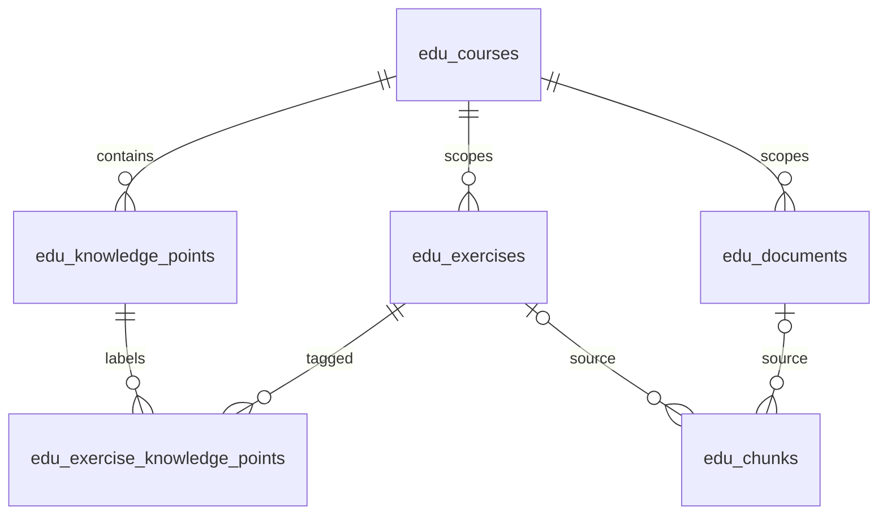

# V0 数据库设计

数据库使用 Supabase 托管 PostgreSQL，并启用 pgvector。所有项目表使用 `edu_` 前缀，避免与其他应用的表重名。

| 表 | 存放内容 | 演示数据量 |
| --- | --- | ---: |
| `edu_courses` | 课程范围：课程体系、学段、年级、学科、学期、教材版本 | 1 |
| `edu_knowledge_points` | 知识点、学习目标和父知识点 | 2 |
| `edu_documents` | 教材或资料的来源、授权说明、处理状态 | 1 |
| `edu_exercises` | 题干、选项、答案、解析、题型、难度和图片引用 | 3 |
| `edu_exercise_knowledge_points` | 一道题与一个或多个知识点之间的关系 | 3 |
| `edu_chunks` | 可检索片段、来源位置、模型名和向量 | 5 |

`edu_schema_migrations` 另行记录已执行的迁移版本。



一个片段必须来自一份资料或一道练习题，二者只能有一个。关联资料、题目、知识点必须属于相同课程，数据库外键会阻止跨课程关联。

## 年级和题型约定

`grade` 使用连续 1–12：小学 1–6，初中 7–9，高中 10–12。例如初三是 `grade=9`、`school_stage=junior_secondary`。首批演示数据是自编小学三年级数学资料，不能视为完整课标。

学科代码是 `math`、`physics`、`chemistry`、`english`。难度是 1–5 的项目内部标签，不代表客观考试难度。题型代码见迁移中的 `question_type` 约束。

## 向量约定

首版预留 `vector(1024)`，适配计划中的 BGE-M3。V0 不下载模型，不调用付费 API，演示片段的 `embedding` 与 `embedding_model` 均为 NULL。`embedded_chunks=0` 是正常结果，不代表已能语义检索。

V1 将生成真实向量，并同时写入实际模型标识。`edu_match_chunks` 必须传入模型名，避免混用来自不同模型的向量。同名模型发生版本或编码配置变化时，也应使用不同的模型标识并重建对应向量。

查询函数支持课程和知识点过滤，使用精确余弦搜索。V0 不创建 HNSW 等近似索引，后续用实测决定是否增加。查询函数本身已经定义，但没有真实向量时不会返回语义匹配。

## 权限范围

V0 的读写由本机 Python 后端通过 PostgreSQL 连接执行。表均开启 RLS，`anon`、`authenticated` 没有直接访问权限，浏览器拿 publishable key 不能直接读取答案或写库。`service_role` 权限保留在服务端；本项目暂不需要配置它的 API key。

本机连接使用 Dashboard 的数据库账户；这是本地开发工具的连接方式。未来公开部署、加入用户系统时，再配置独立后端角色和对应访问策略。当前后端监听 `127.0.0.1`。

## 迁移与数据

`python -m edu_rag.db migrate` 在事务中执行未应用的 SQL，并用 advisory lock 避免同时初始化。已应用迁移按版本跳过；后续改动应增加新文件，不能修改历史文件再期待自动重跑。

`python -m edu_rag.db seed` 只插入演示数据，重复执行不会覆盖已有内容。演示题的检索片段只包含题干；答案和解析仍保存在题目表中，供后续练习页面分别展示。

可以在 SQL Editor 中查看：

```sql
select c.title, k.title as knowledge_point
from public.edu_courses c
join public.edu_knowledge_points k on k.course_id=c.id
order by c.code,k.sort_order;

select code,stem,answer,explanation
from public.edu_exercises order by code;

select count(*) as chunks,
       count(embedding) as embedded_chunks
from public.edu_chunks;
```

